# KeepThis

**Edit with AI. Keep the UX you intended.**
A UX regression guard for AI-powered UI changes.

> AI가 UI를 수정한 뒤, 요청하지 않은 UX까지 함께 바뀌었는지 승인된 Baseline과 근거로 확인하는 가드레일.

KeepThis는 Manifest V3 기반 Chrome 확장 프로그램입니다. 지금 만족하는 화면을 **Baseline**으로 저장해 두고, Claude Code·Codex 같은 AI 도구로 화면을 고친 뒤 **Check Changes**를 누르면 —

1. **코드가** DOM·레이아웃의 객관적인 차이를 계산하고
2. **Gemini가** 그 차이가 사용자가 지키기로 한 **Guardrail**과 충돌하는지만 해석하고
3. **사용자가** 결과를 수용·무시·수정할지 결정합니다.

<p align="center">
  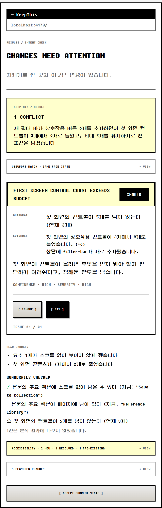
</p>

---

## 왜 필요한가

CSS 오류도, 접근성 위반도 없는데 다음이 조용히 바뀝니다.

- Primary action의 우선순위
- 첫 화면에서 보이는 핵심 콘텐츠의 양
- 핵심 콘텐츠와 보조 컨트롤의 비중
- 탐색 → 미리보기 → 저장 같은 핵심 흐름

AI 코딩 도구는 구조 변경이 커지면 파일을 통째로 재작성하고, 사람은 방금 요청한 기능에 주의가 쏠려 있어 "원래 잘 되던 것"이 흔들린 걸 기억으로 잡아내지 못합니다. DevTools는 *왜 이렇게 동작하는지*, Lighthouse는 *기술 점수*, Visual QA는 *디자인 명세와 같은지*를 답합니다. KeepThis는 그 사이의 질문에 답합니다.

> **"요청한 건 전부 잘 들어갔고 CSS 오류도 없는데, 내가 지키기로 한 게 깨졌는가?"**

### 제품 원칙

```
Do not ask AI to decide whether the design is good.
Ask code what changed,
ask AI whether that measured change conflicts with a user-approved guardrail,
and let the user decide what becomes the next baseline.
```

| Measurement | Interpretation | Decision |
|---|---|---|
| Chrome / TypeScript | Gemini API | User |
| 무엇이 바뀌었는가 | 그 변화가 의도와 충돌하는가 | 수용 · 무시 · 수정 |

KeepThis는 디자인을 채점하거나 "더 예쁘게"를 제안하는 도구가 **아닙니다**. 전체 점수도, 취향 평가도 내지 않습니다.

---

## 주요 기능

| 기능 | 설명 |
|---|---|
| **Baseline 저장** | 현재 viewport 스크린샷 + 정제된 DOM/레이아웃 스냅샷(요소 위치·가시성·개수·제목 계층·준비 상태)을 route 단위로 저장. 입력값·비밀번호·숨김 텍스트는 저장하지 않음 |
| **관찰 기반 Guardrail 후보** | 저장 직후 **코드가** 스냅샷에서 지금 사실인 것을 문장으로 제시 (예: "본문의 주요 액션에 스크롤 없이 닿을 수 있다"). AI 호출 없이 즉시 표시되고, 사용자는 체크·수정·직접 추가만 함 |
| **Local Diff Engine** | 요소 매칭(`data-testid` → stable id → role+name → 구조 경로) 후 추가·삭제·이동·크기·가시성·fold 진입/이탈·컨트롤 수·순서·overlay 가림을 순수 함수로 계산하고 evidence id 부여 |
| **Intent check** | Guardrail이 1개 이상이면 Gemini가 diff + 두 스크린샷을 보고 Guardrail 충돌만 판단. 이슈 최대 3개, 각 이슈는 실제 evidence id와 Guardrail을 인용해야 함 |
| **Change summary** | Guardrail이 0개면 가치 판단 없이 "의미 있는 변화"만 요약. `Add guardrails` → `Analyze again`으로 같은 diff를 재수집 없이 재해석 |
| **첫 화면 영향 우선 결과** | "무엇이 스크롤 없이 안 보이게 됐는가 / 몇 개가 줄었는가"를 먼저, 픽셀 수치는 접힌 근거 영역에 보관 |
| **Severity ≠ Confidence** | UX 영향과 근거의 강도를 분리 표시. 시각 근거만 있으면 high confidence 불가 |
| **Fix Prompt** | 신규 기능을 지우지 않고 유지·축소·이동·보존을 구분한 편집 가능한 수정 지시문. 복사해서 쓰는 AI 도구에 붙여넣기 |
| **Ignore / Accept** | Ignore는 카드만 숨기고 Baseline 불변(사유 3종). `Accept current state`는 확인 dialog를 거쳐 페이지 전체를 새 Baseline으로 교체 |
| **접근성 비교 (axe-core)** | Baseline 대비 새로 생긴 / 해결된 / 기존 접근성 이슈를 규칙별로 묶어 표시 (결정론적 검사, AI 미사용) |
| **잘못된 확신 방어** | 로딩 중·skeleton·viewport 불일치 화면은 API 호출 전에 코드가 차단하고 `Retry` / `Analyze visible elements only` 제공 |
| **BYOK** | 본인 Gemini API 키 사용. 키는 service worker에서만 읽고 content script·대상 페이지에는 전달되지 않음 |

---

## 사용 흐름

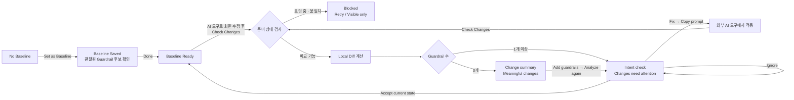

### 화면 스냅샷

> 아래 이미지는 `npm run preview`의 고정 데이터 프리뷰(실제 Side Panel 컴포넌트, 400px 폭)에서 캡처했습니다.

| 1. Baseline 없음 | 2. Baseline 저장 + Guardrail 후보 | 3. Baseline 준비 |
|---|---|---|
| 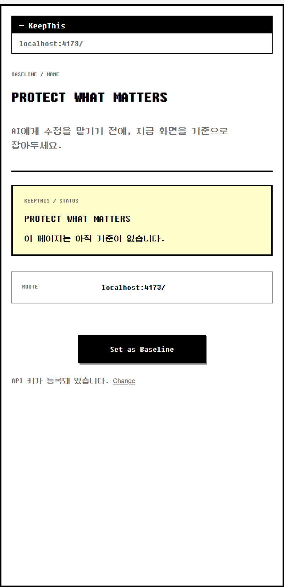 | 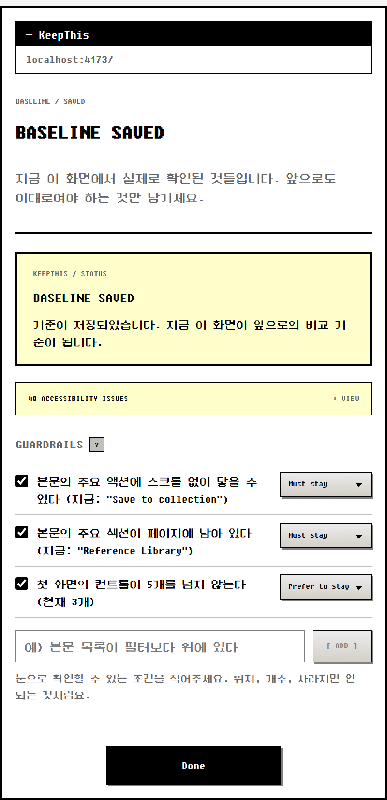 | 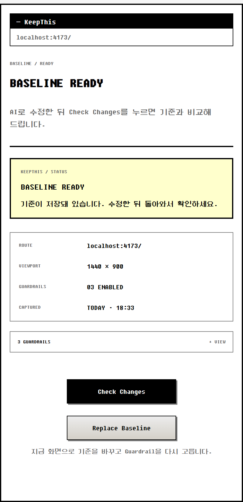 |

| 4. 분석 진행 | 5. Intent check 결과 | 6. Change summary |
|---|---|---|
| 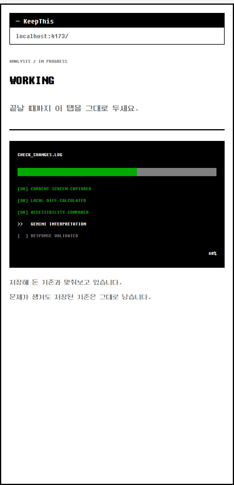 |  | 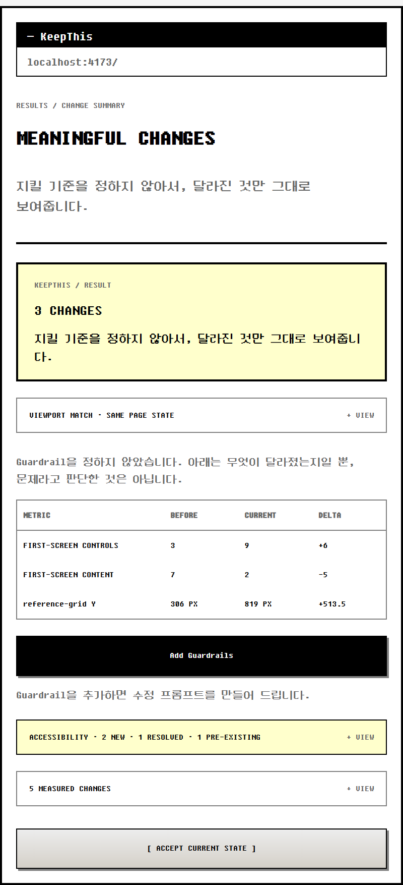 |

| 7. Fix Prompt 편집 | 8. Ignore 사유 | 9. Accept 확인 |
|---|---|---|
| 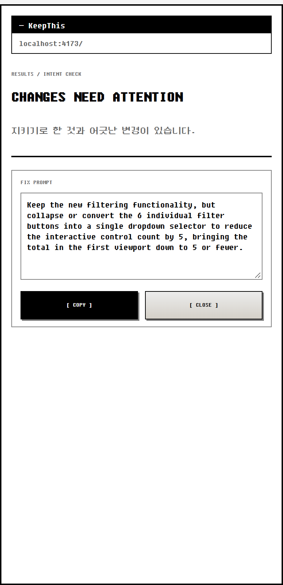 | 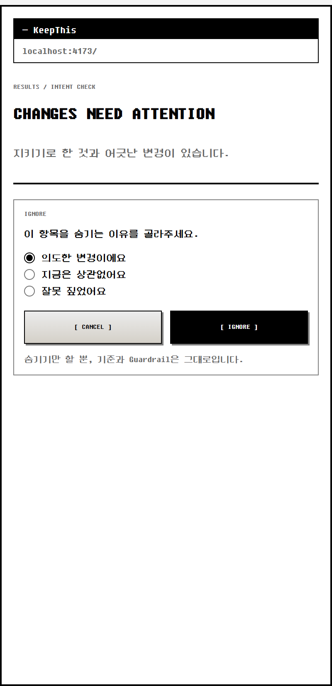 | 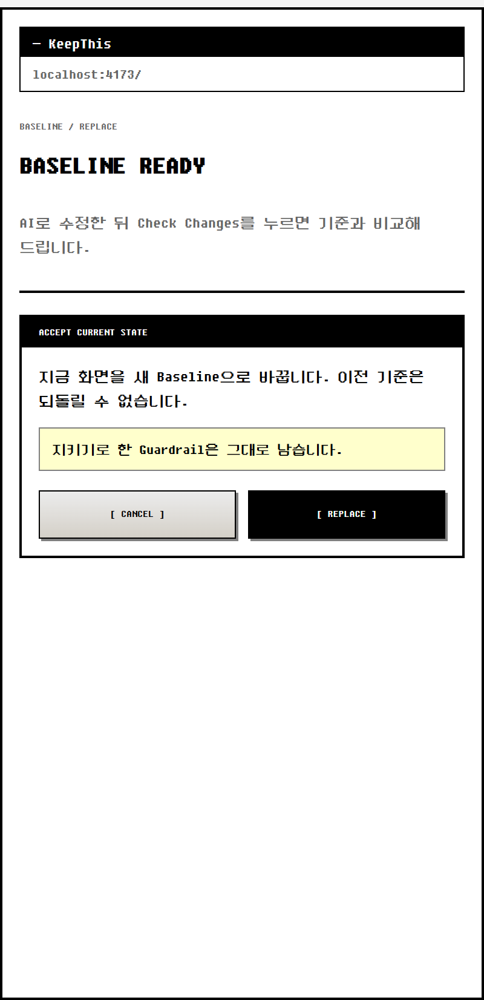 |

| 10. 차단 (로딩 중 화면) | 11. 차단 (Baseline 캡처) | 12. 요청 실패 (rate limit) |
|---|---|---|
| 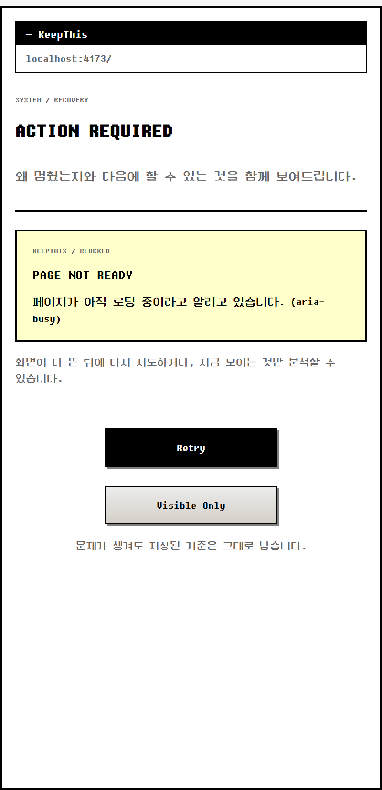 | 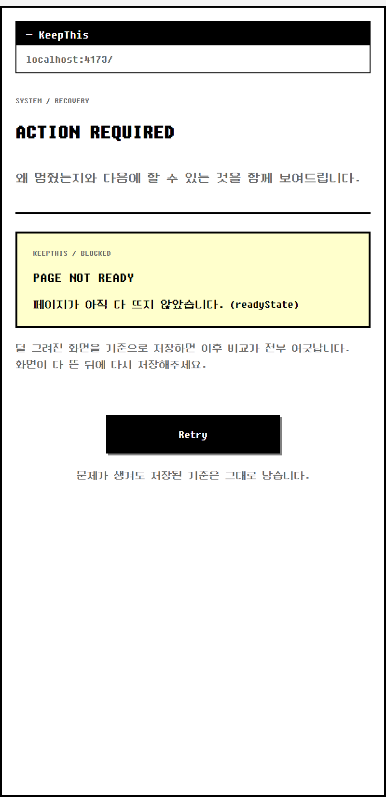 | 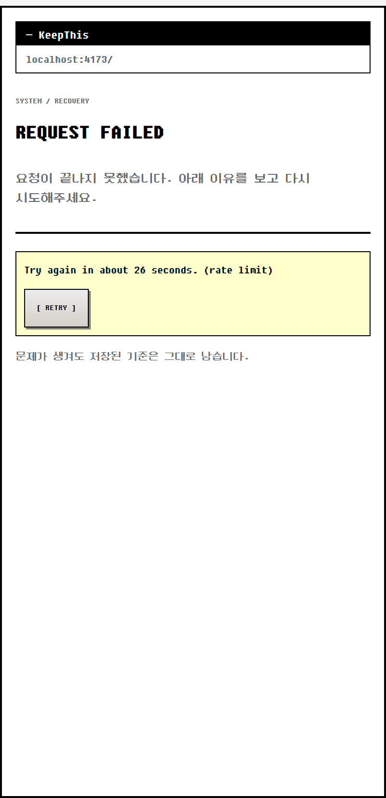 |

### 데모 대상 페이지 (`demo/index.html`)

같은 URL에서 세 가지 상태를 재현합니다. `#changed`는 "필터와 트렌딩 섹션을 추가해줘"라는 요청이 **요청대로 잘 들어간** 상태 — CSS 오류는 없지만 레퍼런스 카드가 첫 화면에서 밀려납니다.

| 기본 (Baseline) | `#changed` (AI 수정 후) | `#loading` (실패 방어) |
|---|---|---|
| 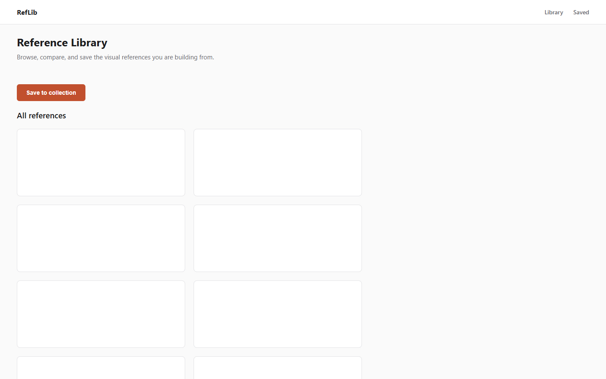 | 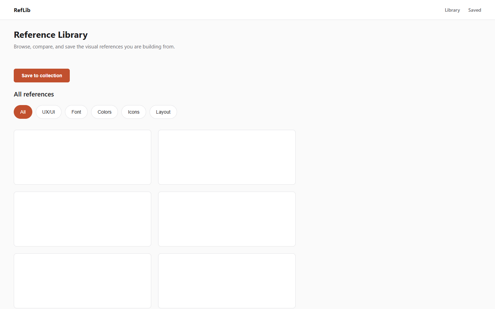 | 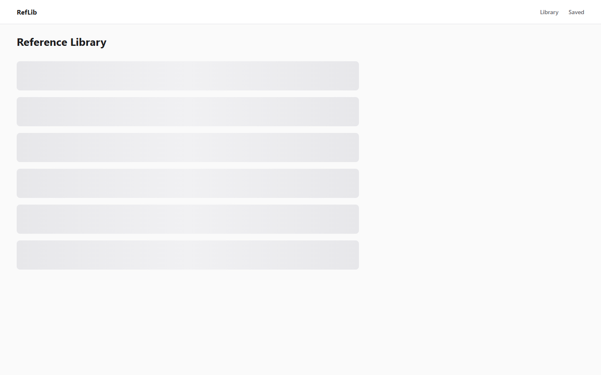 |

---

## 설치와 실행

요구 사항: Node.js 20+, Chrome (Side Panel 지원 버전)

```bash
npm install
npm run build        # dist/ 생성
```

1. Chrome에서 `chrome://extensions` 열기 → **개발자 모드** 켜기
2. **압축해제된 확장 프로그램 로드** → `dist/` 폴더 선택
3. `http://localhost` 또는 `http://127.0.0.1` 페이지에서 확장 아이콘 → Side Panel 열기
4. 처음 실행 시 패널 안에서 본인의 Gemini API 키 입력 ([Google AI Studio](https://aistudio.google.com/apikey)에서 발급)

### 데모 따라하기

```bash
npm run demo         # http://localhost:4173
```

1. `localhost:4173`에서 **Set as Baseline** → 제시된 Guardrail 후보 확인 후 **Done**
2. 주소 끝에 `#changed`를 붙여 이동 (AI가 필터·트렌딩 섹션을 추가한 상태)
3. **Check Changes** → 이슈 카드와 근거 수치 확인 → **Fix**로 수정 지시문 확인
4. `#loading`으로 이동 후 **Check Changes** → API 호출 전에 차단되는지 확인

### 기타 스크립트

| 명령 | 설명 |
|---|---|
| `npm test` | Vitest 단위 테스트 |
| `npm run typecheck` | TypeScript 타입 검사 |
| `npm run preview` | 모든 Side Panel 상태를 고정 데이터로 한 화면에 렌더링 (디자인 검토용, 버튼 동작 없음) |
| `npm run demo:diff` | 데모 fixture로 Local Diff 결과 출력 |

---

## 보안과 데이터

- **API 키는 저장소에 포함되어 있지 않습니다.** 각자 본인 키를 Side Panel에서 입력합니다 (BYOK).
- 키는 `chrome.storage.local`에 저장되며 `TRUSTED_CONTEXTS` 접근 수준으로 content script 접근을 차단합니다. 암호화 보관이 아니므로 평문으로 존재할 수 있습니다. 키 삭제는 service worker의 `DELETE_API_KEY` 메시지로 구현되어 있지만 현재 Side Panel에는 삭제 버튼이 아직 없습니다 — 키를 지우려면 확장 프로그램을 제거하세요.
- 분석 시 **현재 화면과 Baseline 스크린샷, 축약된 DOM/레이아웃 diff, Guardrail**이 Google Gemini API로 전송됩니다. 무료 티어에서는 제출 내용이 제품 개선에 사용될 수 있으므로 **회사 비공개 화면, NDA 자료, 개인정보가 있는 페이지에는 사용하지 마세요.**
- Gemini 호출은 `Check Changes`를 눌렀을 때만 발생합니다. 실시간 감시·백그라운드 폴링은 없습니다.
- 매니페스트 `host_permissions`는 `<all_urls>`입니다. Side Panel에서 `captureVisibleTab`이 `activeTab`을 받지 못하는 Chrome 제약 때문이며, 실제 동작 범위는 코드(`isSupportedRoute()`)에서 `http://localhost`·`http://127.0.0.1`로 제한합니다. `file://` 권한은 요구하지 않습니다.

---

## 기술 구조

```
┌──────────── Target page (localhost) ────────────┐
│ Content Script                                  │
│  semantic DOM · geometry · readiness · axe-core │
└───────────────────┬─────────────────────────────┘
                    │ chrome.runtime messaging
┌───────────────────▼─────────────────────────────┐
│ MV3 Service Worker                              │
│  captureVisibleTab · snapshot orchestration     │
│  Local Diff Engine · storage repository         │
│  Gemini client (key never sent to page)         │
│  zod schema validation                          │
└──────────────┬──────────────────┬───────────────┘
       chrome.storage.local       │ messages
                              ┌───▼───────────────┐
                              │ React Side Panel  │
                              └───────────────────┘
```

| 디렉터리 | 역할 |
|---|---|
| `src/shared/` | 데이터 계약(타입 + zod 스키마), routeKey 정규화, message action·error code |
| `src/content/` | 스냅샷 추출, 준비 상태 신호, 접근성 검사 |
| `src/diff/` | 요소 매칭, diff 계산, 임계값, 관찰 기반 Guardrail 후보, 첫 화면 영향 요약 |
| `src/background/` | service worker, 스냅샷·Check Changes 오케스트레이션, Gemini client, 이슈 정렬 |
| `src/storage/` | Baseline·설정 저장소 (원자적 교체, quota 점검) |
| `src/sidepanel/` | React Side Panel 화면·컴포넌트·문구 |
| `src/preview/` | 고정 데이터 디자인 프리뷰 |
| `demo/` | 3상태 데모 페이지와 시연 대본 |

**스택**: Chrome Extension Manifest V3 · React 18 · TypeScript · Vite · zod · axe-core · Vitest
**AI 모델**: 기본값은 `src/storage/settings-repository.ts`의 `DEFAULT_GEMINI_MODEL` (현재 `gemini-3.6-flash`)

### 검증 상태 (이 저장소 커밋 시점 기준 로컬 실행)

- `npm run typecheck` 통과
- `npm test` — 테스트 파일 26개, 테스트 228개 통과
- `npm run build` 통과

---

## 범위

**MVP에 포함**: localhost·127.0.0.1 전용, viewport 단위 스크린샷, route당 Baseline 1개, 이슈 최대 3개, BYOK.

**의도적으로 제외**: 프롬프트 자동 추적, Git/IDE/CLI 연동, 자동 코드 수정, 전체 페이지 스크롤 캡처, Baseline 히스토리, 실시간 감시·자동 Badge, 프로젝트 지침 파일 읽기, 일반 디자인·성능·SEO 점수, 로그인·서버·팀 기능, Chrome Web Store 배포.

---

## 문서

- [`CLAUDE.md`](CLAUDE.md) — 제품 정의, 확정 결정(D-01~D-09), 데이터 계약, 수용 기준
- [`demo/DEMO-SCRIPT.md`](demo/DEMO-SCRIPT.md) — 시연 대본
